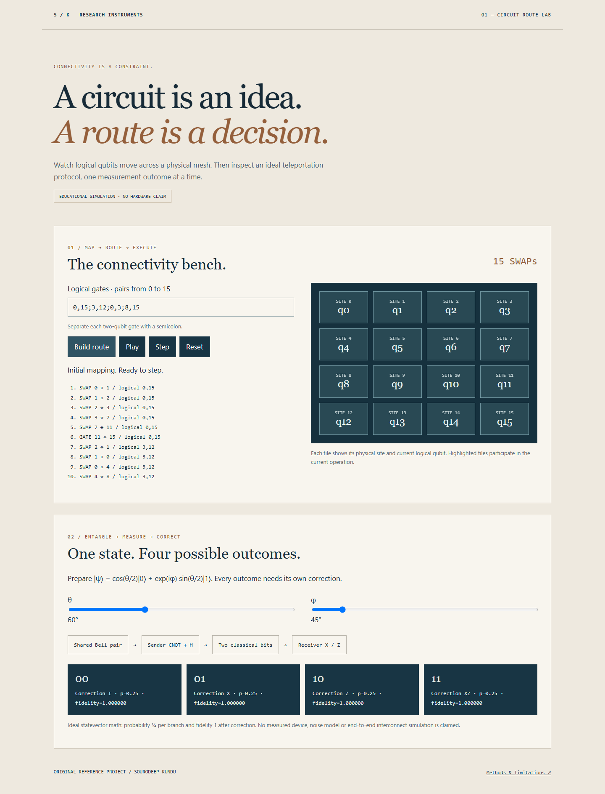

# Circuit Route Lab



[Open the interactive demo](https://sourodeepkundu2025-hub.github.io/circuit-route-lab/)

An interactive laboratory for two questions: **How does limited connectivity change a circuit?** And **what does teleporting a quantum state actually require?**

This is a new, independently authored educational reference project. It connects to my circuit-mapping and quantum-interconnect interests; it is not the source code of a prior paper, internship, patent or employer project.

## Run

Requires Node.js 22+ for tests. The browser lab has no package dependencies or API keys.

```sh
npm test
npm run demo
python -m http.server 8000 --bind 127.0.0.1
```

Open http://127.0.0.1:8000/. Change the gate sequence, play the routing timeline, and inspect each logical-to-physical permutation. Use the quantum-state controls to inspect all four teleportation outcomes.

## Implemented

- A 2–8 square grid, optional blocked links, BFS minimum-hop paths and explicit SWAP events.
- A gate-by-gate greedy routing baseline with complete mapping snapshots.
- An exact eight-amplitude complex statevector for three-qubit ideal teleportation.
- Separate classical measurement bits, conditional X/Z corrections, branch probabilities and state fidelity.
- Deterministic regression tests covering arbitrary complex inputs and 100 synthetic circuit sequences.
- A browser playback with pause, reset, step, keyboard-native controls and reduced-motion behavior.

## Why the details matter

A SWAP updates the location of **both** logical qubits; routing a later gate must use the updated mapping. The final routing edge is already adjacent and needs no further SWAP.

Teleportation consumes a shared Bell pair and uses two classical measurement bits. The receiver applies corrections before obtaining the original state. It does not permit faster-than-light communication.

## Limits and interpretation

The routing policy is a baseline, not an optimal SWAP-count compiler. Minimum-hop individual paths do not prove optimality for an entire circuit. There is no parallel scheduling, crosstalk model or calibrated hardware noise. Grid links are an educational connectivity graph, not a measured wireless NoC.

Teleportation fidelity is calculated under ideal protocol assumptions. A value of 1 is a mathematical simulation result, not a hardware measurement or performance advantage. The route lab and teleportation lab demonstrate separate concepts; SWAP links are not claimed to execute remote teleportation.

## Architecture

`src/lab.mjs` is shared by browser, CLI and tests. `app.mjs` projects its events into the interactive view. No server or external service is required.

## Research connection

My earlier work includes nearest-neighbor circuit transformation and quantum-interconnect simulation. Related publications: [VDAT circuit transformation](https://doi.org/10.1109/VDAT63601.2024.10705747) and [2D synthesis strategy](https://doi.org/10.1007/978-981-97-2611-0_40). Those citations provide context; they do not validate this new implementation.

## Next experiments

Compare this baseline with look-ahead routing on fixed benchmarks; export OpenQASM only after adding gate-semantics validation; evaluate noise separately with named channel parameters. Any stronger claim needs recorded baseline results.

## Contributing

Use a branch and Pull Request. Run `npm test`; include a circuit or state that reproduces the behavior. See [PROVENANCE.md](PROVENANCE.md). CI runs tests on every PR and branch push.
